# Modelo de dados

O esquema executável está nas migrations aditivas em `database/migrations`.

```mermaid
erDiagram
  organizations ||--o{ users : possui
  organizations ||--o{ clients : atende
  organizations ||--o{ commercial_opportunities : negocia
  commercial_opportunities ||--o{ commercial_stage_events : historico
  commercial_stages ||--o{ commercial_opportunities : organiza
  enrollments ||--o| mentorship_contracts : contrato_financeiro
  mentorship_contracts ||--o{ mentorship_payments : recebimentos
  enrollments ||--o| journey_checklists : entrada
  enrollments ||--o{ journey_reviews : revisoes
  enrollments ||--o{ satisfaction_responses : avaliacoes
  satisfaction_responses ||--o{ satisfaction_revisions : correcoes
  users ||--o{ mentor_absences : disponibilidade
  users ||--o{ sessions : acessa
  users ||--o{ access_tokens : ativa
  clients ||--o{ client_members : autoriza
  users ||--o{ client_members : participa
  clients ||--o{ marketplace_accounts : possui
  clients ||--o{ enrollments : contrata
  programs ||--o{ enrollments : define
  enrollments ||--o{ assignments : historico
  users ||--o{ assignments : mentor
  enrollments ||--o{ tickets : atendimento
  enrollments ||--o{ action_plans : objetivos
  action_plans ||--o{ tasks : execucao
  users ||--o{ tasks : responsavel
  organizations ||--o{ diagnosis_templates : modelos
  enrollments ||--o{ diagnoses : avaliacoes
  diagnosis_templates |o--o{ diagnoses : orienta
  diagnoses ||--o{ diagnosis_revisions : publicacoes
  diagnosis_revisions ||--o{ diagnosis_plan_links : fundamenta
  action_plans ||--o{ diagnosis_plan_links : atende
  enrollments ||--o{ indicators : resultados_mensais
  indicators ||--o{ indicator_revisions : publicacoes
  enrollments ||--o{ indicator_goals : metas
  enrollments ||--o{ indicator_imports : lotes_csv
  users ||--o{ indicator_imports : confirma
  action_plans |o--o{ indicator_goals : orienta
  enrollments ||--o{ meetings : encontros
  meetings ||--o{ meeting_participants : presenca
  meetings ||--|| meeting_minutes : rascunho
  meetings ||--o{ meeting_minutes_revisions : publicacoes
  meetings ||--o{ meeting_decisions : decisoes
  meeting_decisions |o--o| tasks : origina
  tickets ||--o{ messages : conversa
  messages ||--o{ attachments : arquivos
  tasks ||--o{ attachments : evidencias
  tickets ||--o{ sla_events : obrigacoes
  users ||--o{ notifications : recebe
  enrollments ||--o{ interventions : intervencao
  enrollments ||--o{ documents : materiais
  documents ||--o{ document_chunks : trechos
```

Usuário é identidade. `client_members` liga a pessoa autorizada à empresa cliente.
Conta de marketplace é independente e múltipla por empresa. Matrícula tem vigência,
situação contratual e etapa de acompanhamento distintas. O campo de matrícula anterior
mantém o vínculo de renovação sem sobrescrever o ciclo original; `journey_renewals`
registra a confirmação idempotente e o novo ciclo. Turmas e grupos WhatsApp não são
confundidos nem implementados agora.

Atribuições têm principal/cobertura, autor, início e fim. Índice parcial impede dois
principais abertos; operações serializam a matrícula antes da substituição. Chaves
compostas organização/recurso impedem os vínculos entre organizações nos relacionamentos
centrais. Datas e estados possuem restrições e índices por carteira, prazo e situação.
`002_action_plans.js` acrescenta planos/tarefas com chaves compostas para impedir
mistura de contratação ou organização. `003_action_signals.js` mantém episódios
persistentes de alertas, independentes da disponibilidade do Redis.
`004_private_attachments.js` acrescenta metadados privados e vínculos compostos que
impedem misturar organização, contratação e mensagem/tarefa. Os bytes ficam em volume
privado, com hash para verificar integridade e estados de gravação pendente/pronta/falha.
`005_meetings.js` acrescenta agenda, presença com nomes/papéis históricos, rascunho
privado, revisões publicadas e decisões estáveis. Chaves compostas impedem converter
decisão em tarefa de outra organização ou contratação. Vínculos únicos preservam
uma tarefa por decisão mesmo com solicitações simultâneas. Notificações podem apontar
diretamente à reunião; os episódios operacionais usam `action_signal_states`.
`006_diagnostics.js` acrescenta modelos editáveis, rascunhos privados, revisões
publicadas e vínculos entre diagnóstico e plano. A cópia do modelo na instância
preserva o contexto original. Publicações possuem hash do conteúdo e versão de
edição de origem; alterações simultâneas exigem a versão esperada. Chaves compostas
impedem associar plano e diagnóstico de organizações ou contratações diferentes.
Índice parcial limita a um plano criado por área/versão, sem impedir outros vínculos
explícitos. Revisar uma avaliação não reescreve a revisão que fundamentou o plano.
`007_indicators.js` acrescenta registro mensal único por contratação, origem da
gravação, rascunho privado, revisões públicas e metas únicas por mês/indicador.
Valores em dinheiro são strings decimais canônicas no JSON; ausência permanece null.
O vínculo opcional da meta ao plano usa chave composta de organização/contratação.
`008_indicator_goal_target_format.js` corrige aditivamente a validação de formato
dos alvos, sem alterar dados e preservando as restrições de faixa e unidade.
`009_indicator_imports.js` acrescenta lotes confirmados com contratação, autoria,
chave única da tentativa por organização, hashes de conteúdo/prévia e relatório
imutável por linha. A prévia assinada não precisa ser persistida. Os novos registros
usam origem `csv`; relatórios e auditoria são gravados na mesma transação dos rascunhos.
O lote preserva seu resultado histórico mesmo após a publicação ou correção dos dados.
`010_commercial.js` acrescenta etapas configuráveis, oportunidades e eventos de etapa
imutáveis. O ganho vincula cliente e matrícula de forma transacional e idempotente.
Contratos financeiros e recebimentos são entidades administrativas separadas, em
reais com precisão decimal; estornos preservam o recebimento e a justificativa.
`011_journey.js` acrescenta versão da jornada/capacidade, checklist, revisões,
renovações únicas da origem, avaliações/revisões e ausências. A matrícula anterior
é preservada, com vínculo composto por organização. Confirmar uma renovação não
transfere tarefas, atas ou resultados do ciclo antigo para o novo.
`012_materials.js` estende documentos e trechos com escopo/visibilidade, rascunho,
publicações imutáveis e arquivos privados por versão. Embeddings continuam ausentes;
busca textual aplica autorização antes de produzir os trechos.
`013_integrations.js` prepara preferências, estados OAuth, credenciais cifradas,
eventos recebidos e tentativas de saída. `014_integration_marketplace_accounts.js`
separa as preferências organizacionais das conexões específicas por conta de
marketplace, com chaves compostas. A existência dessas tabelas não ativa um canal.

Atendimento é o assunto da conversa. Mensagens mantêm tipo, autoria, referência à
mensagem respondida e data de resposta. Obrigações de primeira resposta, próxima
resposta, promessa e resolução são registros distintos. Uma violação não é apagada
quando a obrigação é posteriormente cumprida. Notificações têm chave única por
destinatário/evento/nível. Auditoria guarda ator, ação, entidade, detalhes e instante.

`worker_heartbeats` registra última reconciliação. Alertas operacionais e de jornada
mantêm episódios em `action_signal_states`, com ciência individual nas notificações.
A extensão pgvector continua preparada, sem geração de vetores ou integração externa
ativa. Materiais usam busca textual real com autorização.
